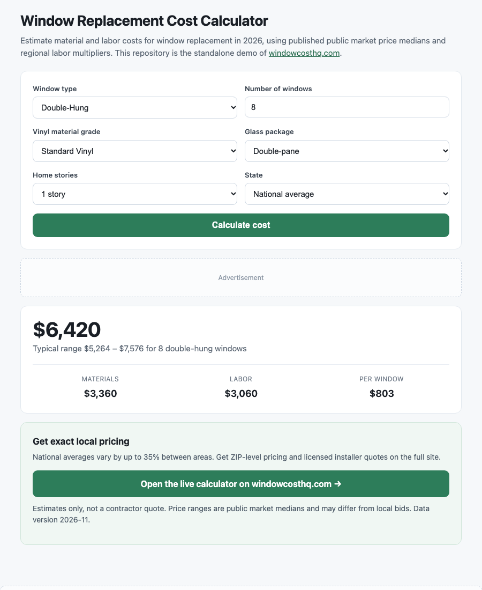

# Window Replacement Cost Calculator

> Published as a read-only reference: see it, use the live site, don't copy it. See [License](#license).

A self-contained, single-file window replacement cost calculator. It gives a material + labor breakdown by window type, glass package, number of windows, stories and US state, and shows a typical price range around the estimate.

This repo is the lightweight, public demo of the calculator on **[windowcosthq.com](https://windowcosthq.com/)** — a site of independent window replacement cost guides, published price data and ZIP-level pricing pages.

- Live calculator: <https://windowcosthq.com/window-cost-calculator/>
- Cost guides: <https://windowcosthq.com/>
- No build step, no dependencies, no tracking: `index.html` is the whole app.



## Run it

Open `index.html` in a browser, or:

```bash
python3 -m http.server 8080
# then open http://localhost:8080
```

## What it does

| Input | Effect |
| --- | --- |
| Window type | Base square footage and complexity multiplier (double-hung, casement, bay/bow, …) |
| Number of windows | Scales materials and labor, capped at 60 |
| Vinyl / fiberglass grade | Material cost per sq ft and efficiency factor |
| Glass package | Added cost per sq ft (double-pane, Low-E, triple-pane) |
| Stories | Labor multiplier for upper-floor access |
| State | Regional labor multiplier, national average by default |

Output is materials, labor, per-window cost, a total and a ±18% typical range. The model and coefficients are in `index.html` and described in [docs/data-model.md](docs/data-model.md).

## Scope and honesty notes

- Estimates only. Not a contractor quote, not a bid, not affiliated with any installer.
- Coefficients come from public market price medians compiled in 2026; they are deliberately coarse and rounded.
- The demo has no backend, so the "get local quotes" button sends you to the live site instead of submitting a lead.

## License

All rights reserved — published for reading and directory listings, not for reuse. Details in [LICENSE](LICENSE). The WindowCostHQ name, price model and copy are © WindowCostHQ. If you want to reuse the calculator, ask: hello@windowcosthq.com.
